<div align="center">

<picture>
  <source media="(prefers-color-scheme: dark)" srcset="assets/branding/dalker-logo-dark.svg">
  
</picture>

# Dalker

**See and control your Windows or Ubuntu computer from any web browser.**

Install Dalker on the computer you want to reach, open its address in a browser on another
device, and you are on its desktop. No account, no cloud service, no app on the viewing side.

[](https://github.com/ivanmakhnyk/dalker/releases/latest)
[](https://github.com/ivanmakhnyk/dalker/actions/workflows/ci.yml)
[](#license)

[Download](#download) ·
[Guides](#guides) ·
[Get started](#get-started) ·
[Using Dalker](#using-dalker) ·
[Settings](#settings) ·
[AI agents](#ai-agents-mcp) ·
[Questions](#questions)

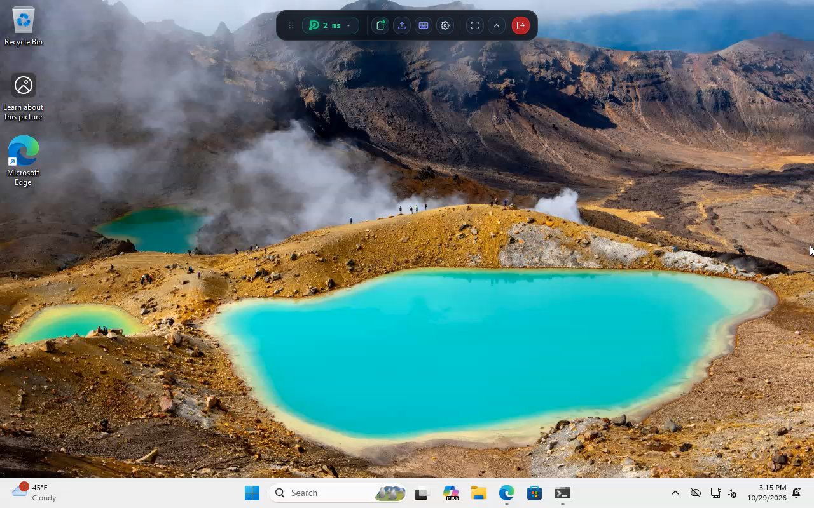

</div>

## Why Dalker

- **Just a browser.** Chrome, Edge, Firefox or Safari on a laptop, tablet or another PC. Nothing to
  install where you sit.
- **Fast and sharp.** The picture travels directly between the two computers, without passing
  through anyone's server, at up to 120 frames per second.
- **Your computer, your rules.** Dalker runs on your own network. There is no sign-up and no
  outside service in between; one password protects access.
- **You always know.** While anyone is connected, a red frame is drawn around the screen. It can't
  be turned off.
- **More than a picture.** Copy and paste text both ways, drag files across, send Ctrl+Alt+Del,
  and reach the Windows sign-in and lock screens.

<div align="center">
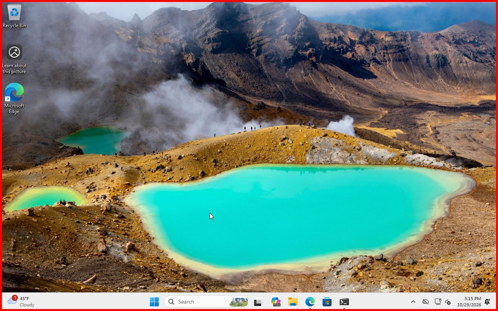
<br><sub>The remote computer while someone is connected: the red frame shows it.</sub>
</div>

## Guides

- **[Getting started](docs/guides/getting-started.md):** install Dalker, choose the password,
  connect and work on the remote computer, step by step.
- **[AI agents (MCP)](docs/guides/ai-agents.md):** turn on the MCP server, create tokens and
  connect Claude, Cursor or LM Studio.

## Download

Get the installer for the computer you want to reach from
**[the latest release](https://github.com/ivanmakhnyk/dalker/releases/latest)**:

| Computer | Download |
|---|---|
| Windows 10 or 11 (64-bit) | `Dalker-<version>-x64.msi` |
| Ubuntu (GNOME desktop) or Debian, 64-bit | `dalker_<version>_amd64.deb` |
| macOS 14 or later, Apple silicon (preview) | `Dalker-<version>.pkg` |

The computer you connect *from* needs only a web browser.

## Get started

### 1. Install Dalker

**Windows:** run the `.msi` and click **Install**. On the last page leave **Open Dalker Settings**
ticked and click **Finish**.

**Ubuntu:** open a terminal in the folder with the download and run

```bash
sudo apt install ./dalker_*_amd64.deb
```

then **log out and back in once** so the desktop loads Dalker's red frame. (Without the frame,
Dalker shows nothing; see [Questions](#questions).)

**macOS:** open the `.pkg`. The first time, macOS blocks it because it isn't notarized: open
**System Settings → Privacy & Security** and click **Open Anyway**. When Dalker starts, allow it
under **Screen & System Audio Recording** and **Accessibility** in the same settings page, then
choose **Quit Dalker** in its menu bar icon and open **Dalker** from Applications again.

Dalker now runs in the background and starts with the computer.

### 2. Choose a password

Open **Dalker Settings** (Windows: the Start menu; Ubuntu: the app grid; macOS: the menu bar
icon). On Windows and Ubuntu it asks for administrator rights. Under **Web Remote Access**, type an access password and click **Apply**.

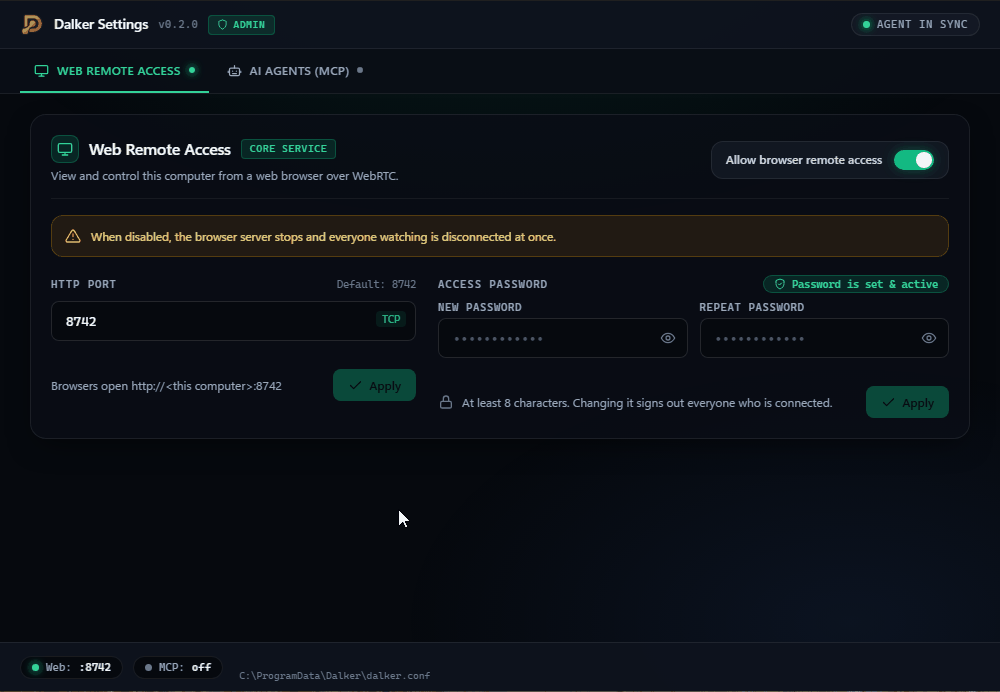

Until a password is set, nobody can connect.

### 3. Connect

On the other device, open

```text
http://<the computer's IP address>:8742
```

and sign in with the access password. (Find the IP address with `ipconfig` on Windows,
`hostname -I` on Ubuntu, or `ipconfig getifaddr en0` on macOS.)

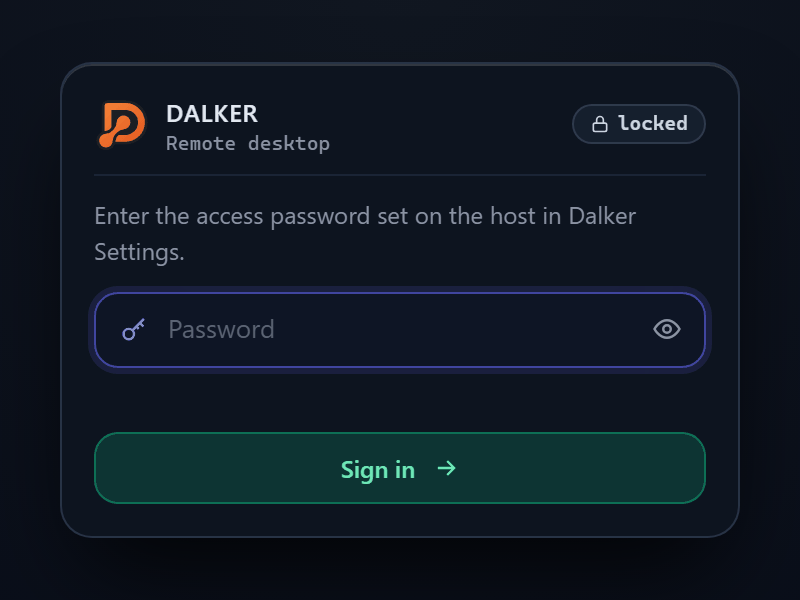

## Using Dalker

Click the remote screen once and your mouse and keyboard work there. The toolbar at the top holds
everything else; drag it by its handle to move it, or fold it away with the arrow.

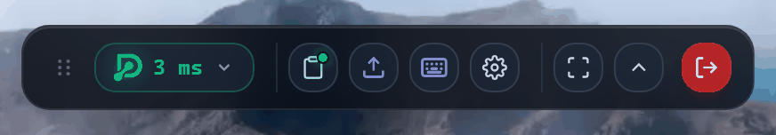

| Button | What it does |
|---|---|
| **Status** | The Dalker logo shows the connection: green when connected, amber while connecting, red when it failed, grey when disconnected. Click for details: resolution, frame rate, delay. |
| **Clipboard** | Copy and paste text between the two computers (see below). |
| **Files** | Send files to the remote computer or fetch files from it. |
| **Keys** (keyboard icon) | Send Ctrl+Alt+Del, the Windows key, Alt+Tab and other combinations your own computer would catch. |
| **AI agents** | Manage access for AI assistants (shown when that's turned on). |
| **Settings** | Frame rate, bandwidth and resolution of the picture, fit-to-window or 1:1 view, keyboard mode, scrolling direction, and keeping the remote computer awake. |
| **Fullscreen** | Use the whole screen. Keyboard shortcuts then go to the remote computer too. Press Esc twice to leave. |
| **Disconnect** | End the session. The red frame on the remote computer goes away. |

### Connection details

Click the status pill to see the remote computer's name and system, the picture's resolution and
frame rate, the delay, packet loss and whether the connection is direct.

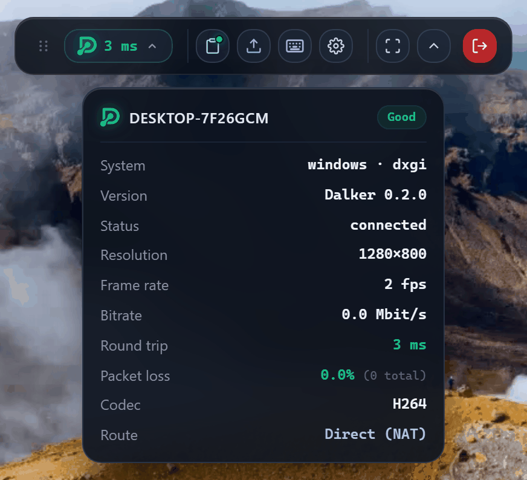

### Copy and paste

Press Ctrl+V on the remote screen to paste text you copied on your computer. Text copied on the
remote computer arrives on your clipboard; the dot on the clipboard button turns green when both
sides match. The clipboard panel also lets you move text by hand.

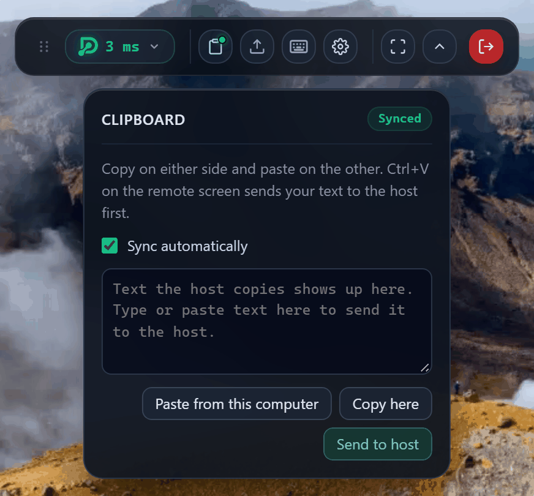

### Files

Drag files onto the remote screen, or into the panel, to send them; they land in the **Downloads**
folder of the person signed in there. **Get files from host** lets you browse their home folder
and download files, with progress, pause and cancel.

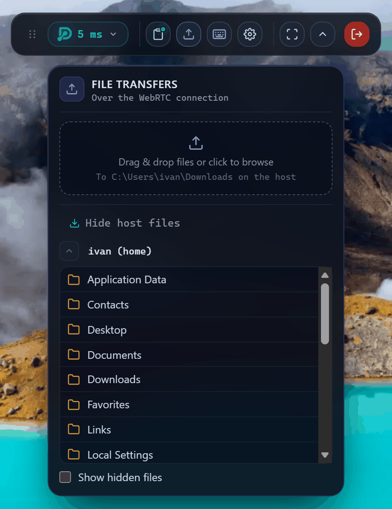

### Keys and keyboard mode

**Keys** sends combinations your own computer would otherwise catch: Ctrl+Alt+Del (which also
opens the Windows sign-in screen), the Windows key, Alt+Tab, Ctrl+Shift+Esc.

The keyboard mode decides how typing works. *Hardware* (the default) sends keys by position, so
the remote computer's layout decides the letters; that's best for shortcuts. If your layout
differs from the remote computer's, choose *Direct text* to type exactly what your keyboard shows.

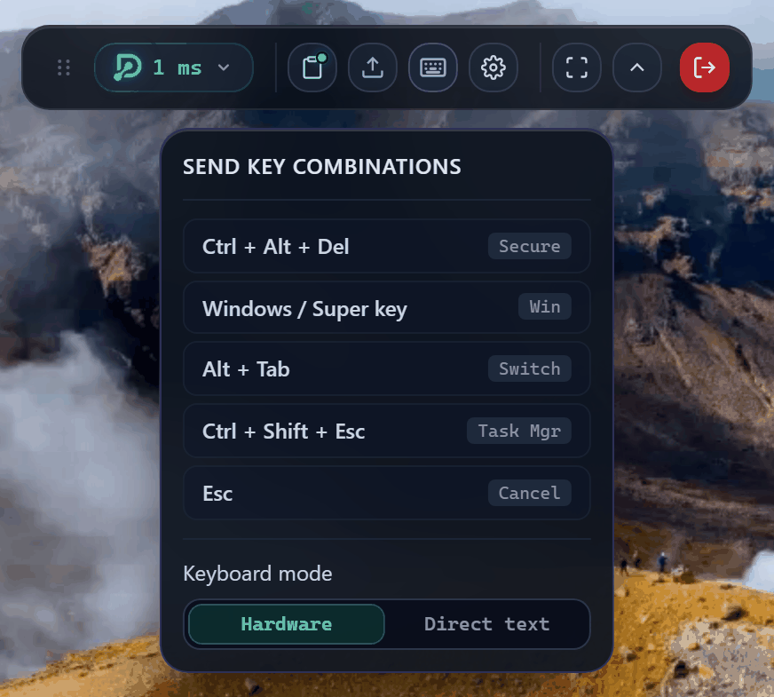

### Your session's settings

The gear sets the frame rate, bandwidth and resolution for your session, fit-to-window or 1:1
view, natural scrolling, and a keep-alive that stops the remote computer from sleeping while you
watch.

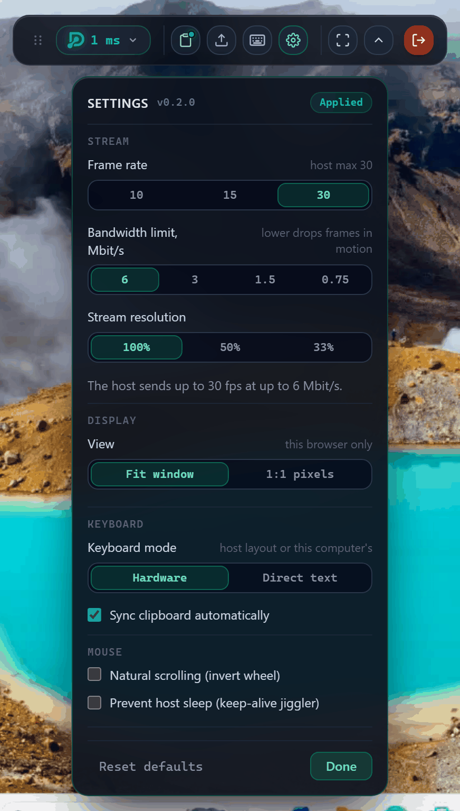

### Locked or signed out?

On Windows you can see and use the lock and sign-in screens: click the screen or press a key, or
use **Keys → Ctrl + Alt + Del**, then type the Windows password.

### Ubuntu too

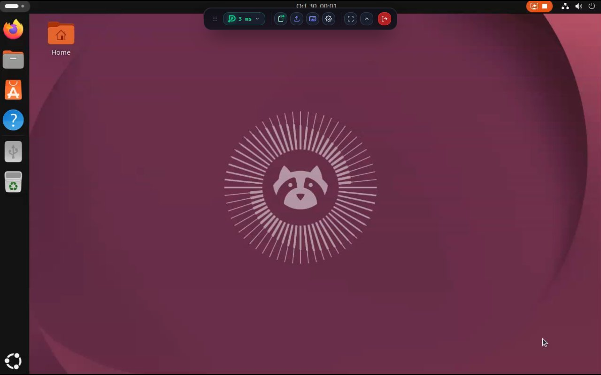

## Settings

**Dalker Settings** on the remote computer controls who can connect and how:

- **Web Remote Access:** turn browser access on or off, change the port (8742 by default) and the
  access password. Changing the password signs everyone out.
- **AI Agents (MCP):** let AI assistants use the computer, with their own access tokens; see below.

Changes apply within a few seconds; nothing needs a restart.

## AI agents (MCP)

Dalker can let an AI assistant such as Claude see the screen and use the mouse and keyboard, the
same way a person does in the browser. It is **off** until you turn it on.

1. In **Dalker Settings → AI Agents**, switch the MCP server on. It only accepts AI apps on the
   same computer until you also switch on **Allow other computers**.
2. Click **Generate New Token**, give it a name and choose what it may do: look at the screen,
   use mouse and keyboard, use the clipboard.
3. Click **MCP config…**, copy the configuration for your app and paste it into your AI app's settings (Claude Code, Claude
   Desktop, Cursor, LM Studio, Windsurf).

An assistant counts as a viewer: the red frame is on while it works, and revoking its token
disconnects it at once. The [AI agents guide](docs/guides/ai-agents.md) walks through every step.

> [!WARNING]
> Whatever is on the screen reaches the AI, including web pages or messages that might try to give
> it instructions. Grant only what's needed, use a separate computer or VM for unattended work,
> and watch the first runs.

## Questions

**Can I connect over the internet?**
Dalker is made for your home or office network. To reach it from outside, connect to that network
first with a VPN (for example WireGuard or Tailscale), then use the same address. If you run a
reverse proxy and can forward a UDP port on your router, see
[Behind a reverse proxy](docs/guides/reverse-proxy.md).

**Is the connection encrypted?**
The picture and your input are always encrypted (WebRTC). The sign-in page uses plain HTTP, so use
Dalker on a network you trust, over a VPN, or behind an HTTPS reverse proxy.

**The page opens but the picture stays black.**
Check that a firewall allows Dalker (the Windows installer adds the rule itself). On Ubuntu,
make sure you logged out and back in after installing; `journalctl -u dalker` says what's
missing.

**I forgot the access password.**
Open Dalker Settings on that computer and set a new one. From a terminal you can also run
`sudo dalkerd set-password` (Ubuntu), or on Windows, in a Command Prompt run as administrator,
`"C:\Program Files\Dalker\dalkerd" set-password` (without `.exe`, so the prompt waits for it).

**Which Linux desktops work?**
Ubuntu's standard GNOME desktop (Wayland or Xorg), Xorg sessions, and KDE Plasma, sway and other
Wayland desktops that have xdg-desktop-portal screen sharing and the layer-shell protocol. On
those, the first time someone connects, a "share your screen" dialog opens on the host: someone
at the computer has to pick the screen and click **Share** once (keep "Allow restoring on future
sessions" ticked), and later connections start without asking. The Ubuntu login screen is not
supported yet. With several monitors, the main one is shown (on KDE and sway, the one picked in
that dialog).

**Where are the logs?**
Windows: `C:\ProgramData\Dalker\logs`. Ubuntu: `journalctl -u dalker`. macOS:
`~/Library/Logs/Dalker`.

**How do I uninstall?**
Windows: **Settings → Apps → Dalker → Uninstall**. Ubuntu: `sudo apt remove dalker`. macOS: see
[How the host runs → macOS](docs/DEVELOPMENT.md#macos).

## For developers

Configuration options, command-line flags, building from source, the architecture and the wire
protocol are in **[docs/DEVELOPMENT.md](docs/DEVELOPMENT.md)**. Releases are described in
[RELEASING.md](RELEASING.md).

## License

Copyright (C) 2026 Ivan Makhnyk and Dalker contributors.

Dalker is free software: you can redistribute it and/or modify it under the terms of the
**GNU Affero General Public License, version 3** ([LICENSE](LICENSE), SPDX: `AGPL-3.0-only`).
It is distributed in the hope that it will be useful, but WITHOUT ANY WARRANTY; without even the
implied warranty of MERCHANTABILITY or FITNESS FOR A PARTICULAR PURPOSE.

In short: you may use, study, change and share Dalker freely. If you distribute Dalker, or a
modified version of it, or let people use a modified version over a network (for example as a
hosted or managed service), you must offer them the complete corresponding source code under the
same license.

**Commercial license.** If you want to embed Dalker in a closed-source product or offer it as a
service without the AGPL obligations, a separate commercial license is available from the
copyright holder. See [COMMERCIAL.md](COMMERCIAL.md).

Contributions are accepted only with a [copyright assignment](CLA.md) to the maintainer; see
[CONTRIBUTING.md](CONTRIBUTING.md).
