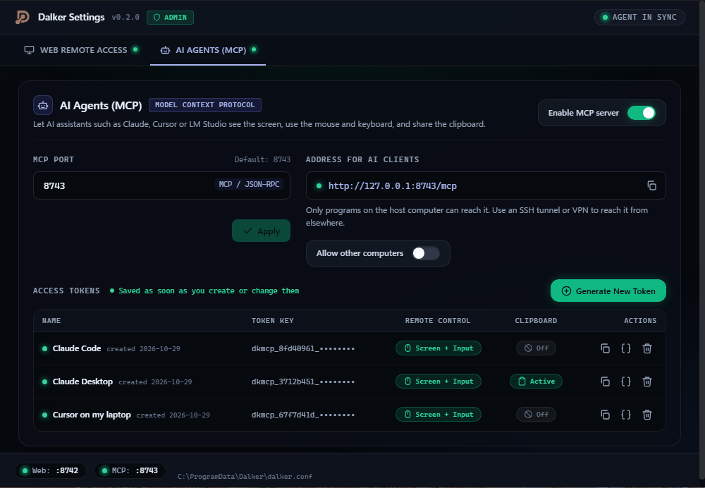
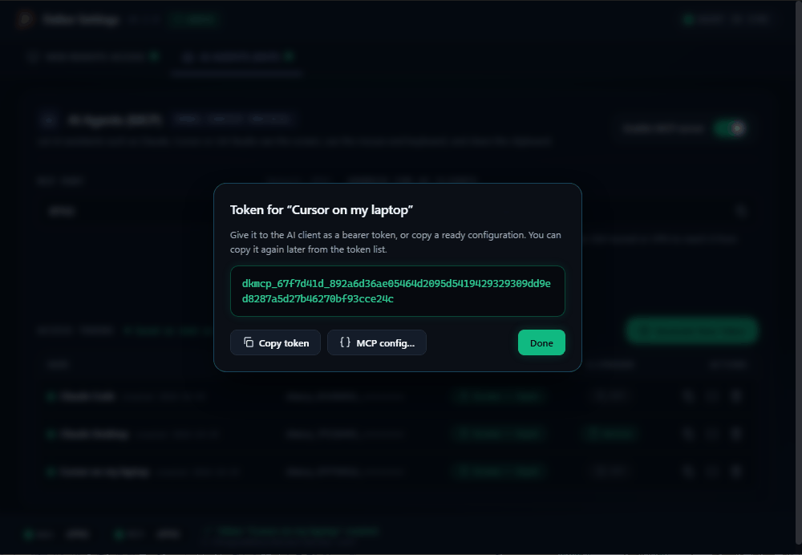
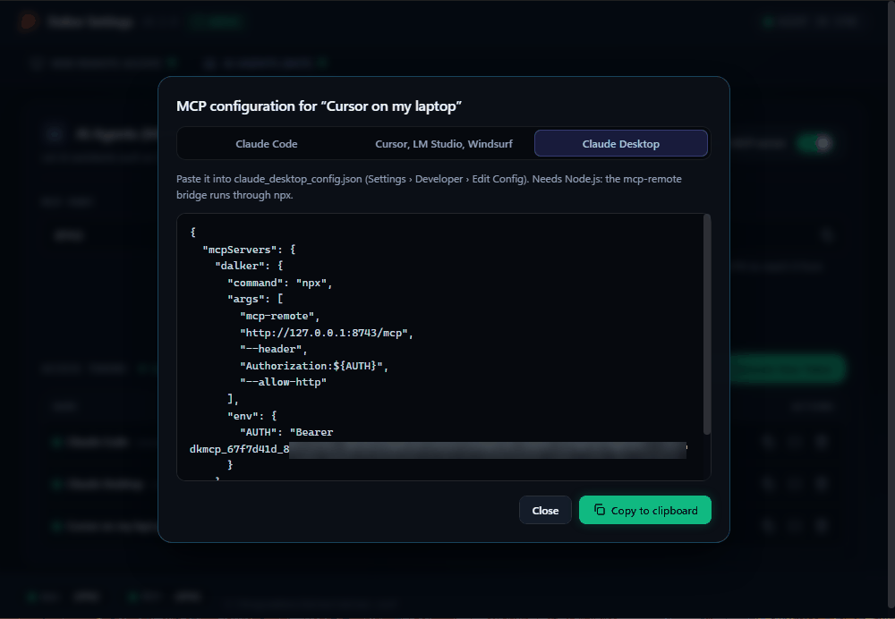

# Let an AI assistant use your computer (MCP)

Dalker has a built-in [Model Context Protocol](https://modelcontextprotocol.io) (MCP) server. With
it, an AI assistant such as Claude Code, Claude Desktop, Cursor, LM Studio or Windsurf can look at
the host's screen and use its mouse, keyboard and clipboard, the same way you do in the browser.

It is **off** until you turn it on, and each assistant needs its own **token** that you can take
back at any time. While an assistant is connected, the red frame is drawn around the host's screen,
just as for a person.

Before you start, install Dalker on the host (see [Getting started](getting-started.md)).

## Step 1. Turn on the MCP server

1. On the host, open **Dalker Settings** (on Windows and Linux, confirm the administrator prompt).
2. Open the **AI Agents (MCP)** tab.
3. Switch on **Enable MCP server**.



Within a few seconds the footer shows **MCP: :8743** with a green dot, and **Address for AI clients** shows where assistants
connect, `http://127.0.0.1:8743/mcp` by default.

### AI app on another computer?

By default only AI apps on the host itself can connect. If the assistant runs on another computer:

1. Switch on **Allow other computers**. AI apps elsewhere then use the host's IP address, for
   example `http://192.168.1.20:8743/mcp`.
2. Use it only on a network you trust: the token travels unencrypted, like the web password. Over
   the internet, connect through a VPN or an SSH tunnel instead:
   ```bash
   ssh -L 8743:127.0.0.1:8743 you@host
   ```
   and keep using `http://127.0.0.1:8743/mcp` with **Allow other computers** off.

To use a different port, type it under **MCP Port** and click **Apply** (8743 by default).

## Step 2. Create a token

1. Click **Generate New Token**.
2. Name it after the app that will use it, for example `Claude Desktop on my laptop`.
3. Choose what it may do:
   - **Allow screen capture & remote control:** see the screen, move and click the mouse, type.
     Almost every assistant needs this. (A token that may only look, not touch, can be made on
     the command line: `dalkerd mcp-token create --name <name> --scopes view`, as administrator on
     Windows, with `sudo` on Linux, and on macOS as
     `/Applications/Dalker.app/Contents/MacOS/dalkerd`.)
   - **Allow clipboard access:** read and write the host's clipboard. Leave it off unless needed.
4. Click **Generate**.



You can copy a token again later from the list; you don't have to save it anywhere.

## Step 3. Connect your AI app

In the token window click **MCP config…**, choose your app, and click **Copy to clipboard**. The
window says where to paste it.



| App | What to do with it |
|---|---|
| **Claude Code** | Run the `claude mcp add --scope user ...` command in a terminal. It keeps the token in your own `~/.claude.json`, out of your projects. |
| **Claude Code (project)** | Paste it into `.mcp.json` in your project. That file only says `Bearer ${DALKER_MCP_TOKEN}`: set the `DALKER_MCP_TOKEN` environment variable to the token where Claude Code starts. |
| **Claude Desktop** | Settings → Developer → **Edit Config** (`claude_desktop_config.json`). Needs [Node.js](https://nodejs.org), because Claude Desktop reaches Dalker through the `mcp-remote` bridge. |
| **Cursor, LM Studio, Windsurf** | the app's `mcp.json` (LM Studio: Program → Edit mcp.json) |

Restart or reload the app.

> **Keep tokens out of Git.** A token in a project's `.mcp.json` or `mcp.json` is easily
> committed and pushed. Use the user-wide Claude Code command or the environment variable, and
> revoke a token that was ever committed.

Then try a first request, for example *"Take a screenshot of my computer and tell me which windows
are open."*

## What the assistant can do

| Ability | Needs |
|---|---|
| Read host information, take screenshots (also zoomed in) | remote control |
| Move, click, drag, scroll; type text; press shortcuts such as Ctrl+C or Alt+Tab | remote control |
| Read and set the clipboard | clipboard |

Every action is written to the host's log with the token's name, but never the typed text or
clipboard contents.

## Managing access

In **AI Agents (MCP)** each token has its own row:

- switch **Remote Control** or **Clipboard** on and off at any time, without a new token;
- copy the token or its configuration again;
- **Revoke** it: assistants using it are disconnected at once and it can't be used again.

To stop all assistants at once, switch off **Enable MCP server**. Assistants that stay idle for 10
minutes are disconnected automatically, and an assistant that quits or crashes is disconnected
within seconds (the red border goes off). When the host already has as many assistants or viewers
as it allows, a new assistant can't connect and is told why.

People signed in to the web client can manage tokens too, from the **AI agents** button in the
toolbar (shown while the MCP server is on). Only the host's Dalker Settings can turn the server on
or off, change its port, or allow other computers.

## Stay safe

- **Everything on the screen reaches the AI.** A web page, document or e-mail can contain text that
  tries to give the assistant instructions. Watch the first runs, and use a separate computer or
  virtual machine for unattended work.
- **Give the least access that works.** Leave the clipboard off unless the task needs it.
- **One token per app.** Then you can revoke one without touching the others.
- **Revoke tokens you no longer use.**

For the command line (`dalkerd mcp-token`) and the config file settings, see
[docs/DEVELOPMENT.md](../DEVELOPMENT.md#ai-agents-mcp-reference).
