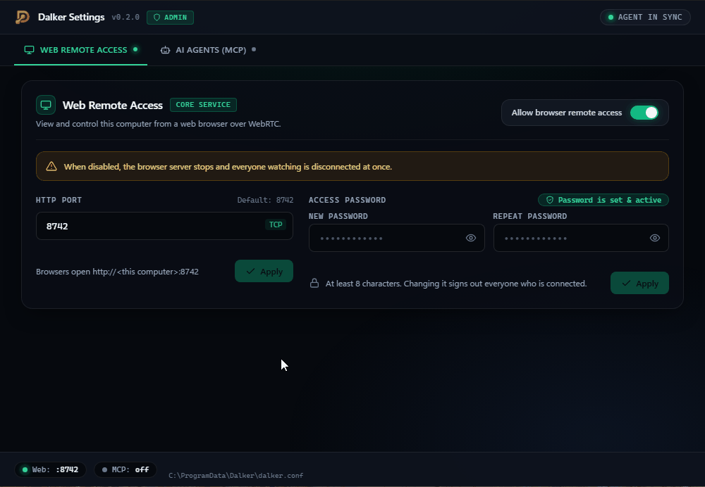
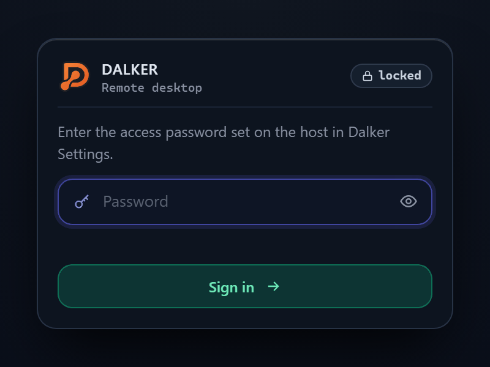
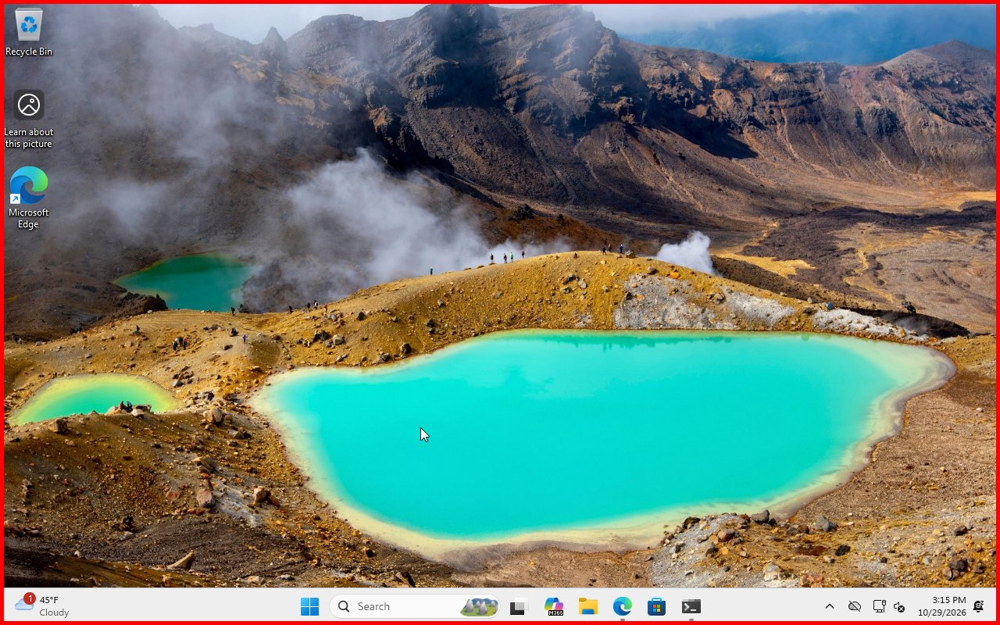
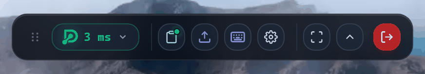
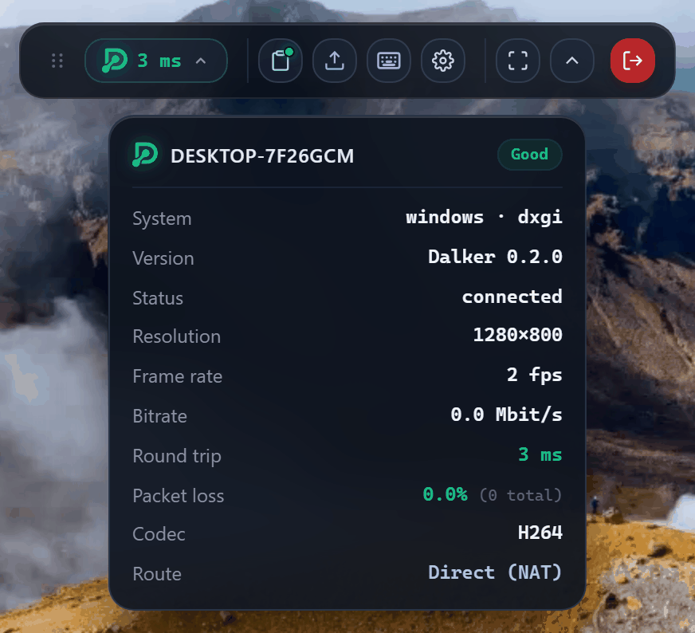
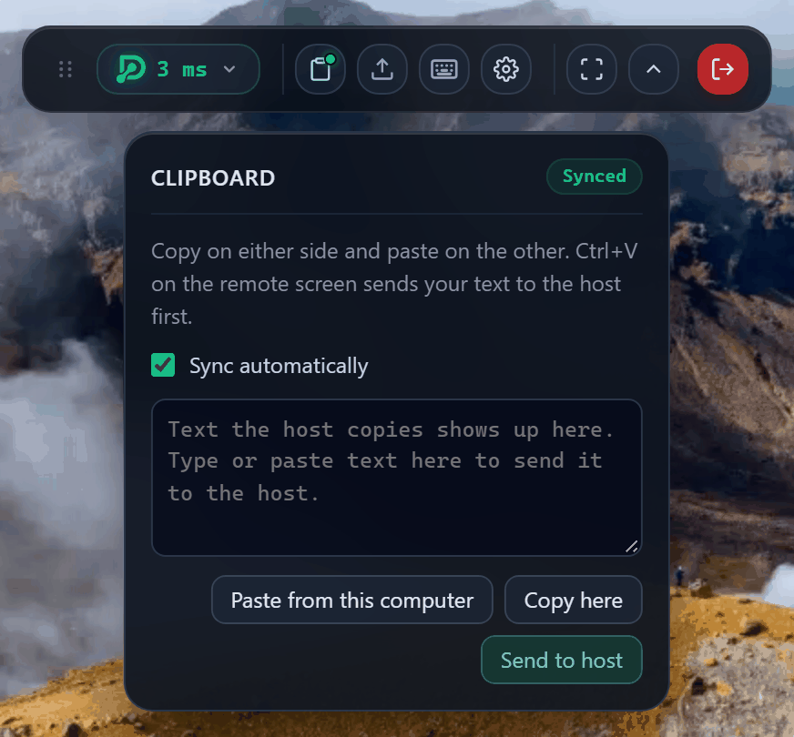
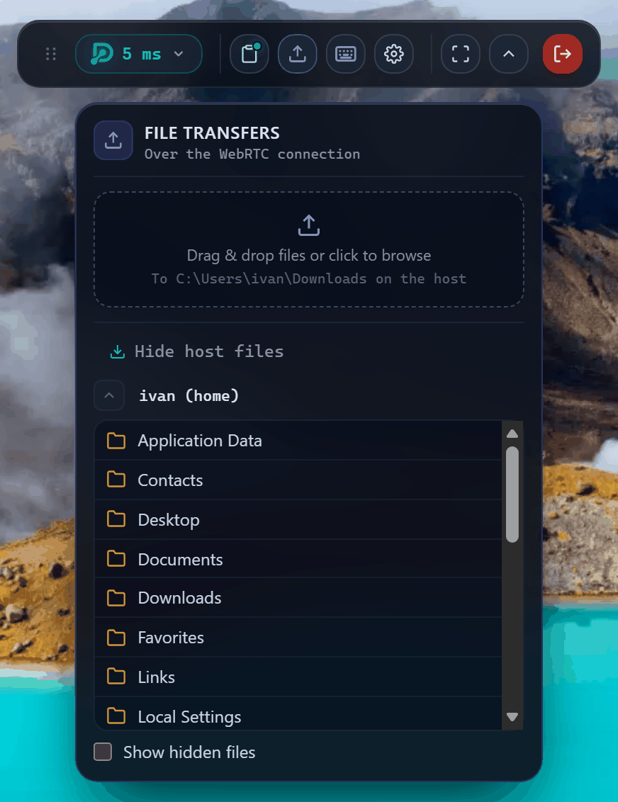
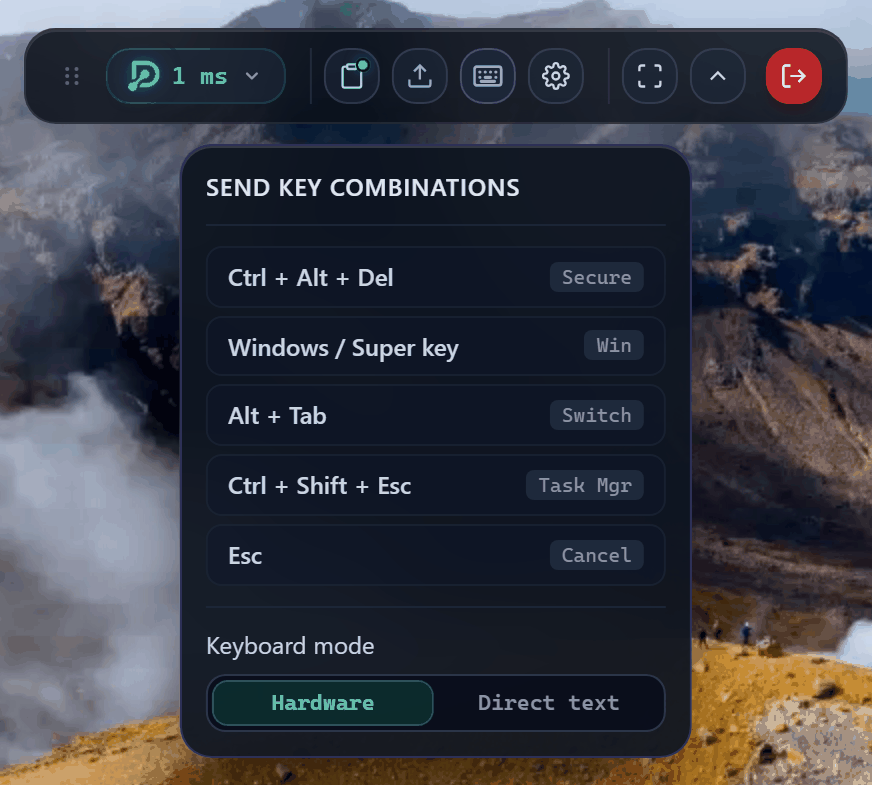
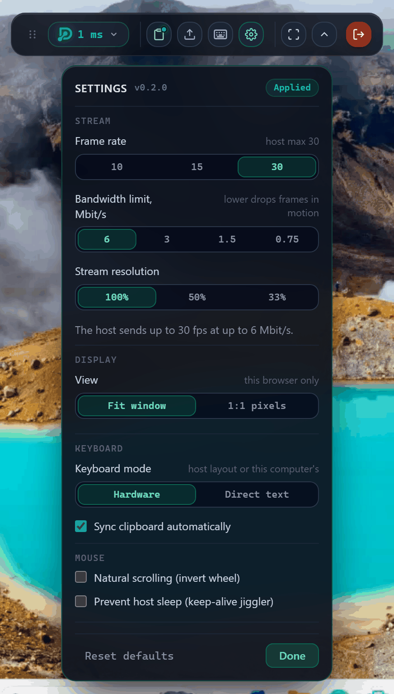
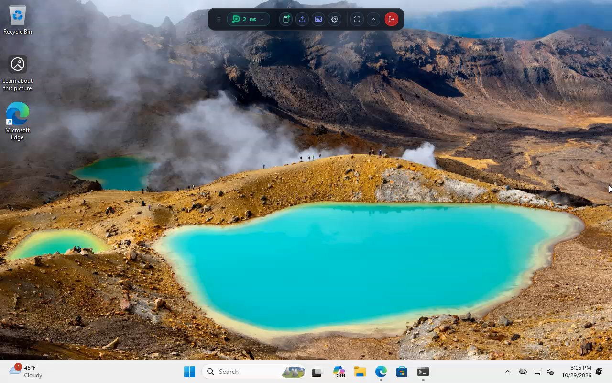

# Getting started with Dalker

This guide takes you from download to controlling your computer in a browser. It takes about five
minutes.

You need:

- the computer you want to reach (the **host**): Windows 10 or 11, Linux (Ubuntu's standard
  GNOME desktop is the tested one; see [Platform support](../../README.md#platform-support)), or
  macOS 14 or later on Apple silicon;
- a device to connect from (the **viewer**): any laptop, PC or tablet with Chrome, Edge, Firefox
  or Safari, on the same network as the host.

## Step 1. Download

On the host, open [the latest release](https://github.com/ivanmakhnyk/dalker/releases/latest)
and download:

- **Windows:** `Dalker-<version>-x64.msi`
- **Ubuntu or Debian:** `dalker_<version>_amd64.deb`
- **macOS:** `Dalker-<version>.pkg`

## Step 2. Install

### Windows

1. Double-click the `.msi`.
2. Click **Install** and allow the change when Windows asks.
3. On the last page leave **Open Dalker Settings to choose the access password** ticked and
   click **Finish**.

Dalker now runs as a Windows service. It starts with the computer, before anyone signs in, so you
can also reach the Windows sign-in screen.

### Ubuntu

1. Open **Terminal** in the folder with the download (usually `~/Downloads`).
2. Run:
   ```bash
   sudo apt install ./dalker_*_amd64.deb
   ```
3. **Log out and back in** (or restart). This loads the small GNOME extension that draws the red
   frame while someone is connected. Dalker shows nothing until it is loaded.

Dalker now runs as the `dalker` system service and starts with the computer.

### macOS

1. Open the `.pkg`. The first time, macOS blocks it because it isn't notarized: open
   **System Settings → Privacy & Security** and click **Open Anyway**.
2. When Dalker starts, allow it under **Screen & System Audio Recording** and **Accessibility**
   on the same settings page.
3. Choose **Quit Dalker** in its menu bar icon and open **Dalker** from Applications again.

Dalker now runs in the background and starts when you sign in.

## Step 3. Choose an access password

The access password is the only thing a viewer needs to connect, so pick a strong one (at least 8
characters).

1. Open **Dalker Settings**:
   - Windows: Start menu → **Dalker Settings** (it opens by itself after installing);
   - Ubuntu: open the app grid and search for **Dalker Settings**;
   - macOS: click the Dalker icon in the menu bar.
2. On Windows and Ubuntu, confirm the administrator prompt (UAC on Windows, your password on
   Ubuntu).
3. In **Web Remote Access**, type the password under **New password** and again under **Repeat
   password**, then click **Apply**.



Viewers open `http://<this computer>:8742`, where *this computer* is the host's IP address. To
find it, run `ipconfig` on Windows (the "IPv4 Address" line), `hostname -I` on Ubuntu, or
`ipconfig getifaddr en0` on macOS.

> Nobody can connect until a password is set. Changing the password later signs out everyone who
> is connected.

## Step 4. Connect from another device

1. On the viewer, open the host's address in the browser, for example `http://192.168.1.20:8742`:
   ```text
   http://<host IP address>:8742
   ```
2. Type the access password and click **Sign in**.

   

3. The host's screen appears. A red frame is now drawn around the host's screen, so whoever sits
   there knows a viewer is connected:

   

Tip: let your browser's password manager save the password; Dalker files it under the host's
address.

## Step 5. Work on the remote computer

Click the picture once: from now on your mouse and keyboard act on the host. The toolbar at the top
has everything else.



- **Connection details:** the Dalker logo in the status pill is green while connected (amber while
  connecting, red if the connection failed). Click it for resolution, frame rate, delay and route.

  

- **Copy and paste text:** copy on one computer, paste on the other. On the remote screen use
  Ctrl+V as usual. The dot on the **clipboard** button is green when both sides match.

  
- **Send files:** drag files from your computer onto the remote screen. They are saved in the
  **Downloads** folder of the person signed in on the host. To fetch files, open the **files**
  button and choose **Get files from host**.

  
- **Special keys:** **Keys** (the keyboard button) sends Ctrl+Alt+Del, the Windows key, Alt+Tab and Ctrl+Shift+Esc,
  which your own computer would otherwise catch.

  
- **Fullscreen:** use the whole screen; system shortcuts then go to the host too. Press Esc twice
  to leave.
- **Settings (gear):** frame rate, bandwidth and resolution, fit-to-window or 1:1 view, keyboard
  mode, natural scrolling, and keeping the host awake while you're idle. These apply to your
  session only.

  
- **Move the toolbar** by dragging its handle (double-click the handle to put it back), or fold it
  away with the arrow.
- **Disconnect** with the red button. The frame on the host disappears.



### Typing in another language

By default keys are sent by their position, and the host's keyboard layout decides which letter
appears. That is what you want for shortcuts. If your keyboard layout differs from the host's,
switch **Keys → Keyboard mode** (or the gear → **Keyboard mode**) to **Direct text**: what you type
is what appears, and shortcuts still work.

### The host is locked or nobody is signed in

- **Windows:** you see the lock or sign-in screen. Click the screen or press a key to bring up the
  password box, or use **Keys → Ctrl + Alt + Del**, then type the Windows password.
- **Ubuntu:** you see the lock screen and can unlock it by typing the password. The Ubuntu login
  screen after a restart is not shown yet: someone has to sign in at the computer first.

## Changing settings later

Open **Dalker Settings** on the host again to:

- turn browser access off (everyone watching is disconnected at once);
- change the port (8742 by default) and click **Apply**;
- change the access password.

Changes apply within a few seconds without a restart.

## If something doesn't work

| Problem | What to try |
|---|---|
| The page doesn't open | Check the address and that both devices are on the same network. Is **Allow browser remote access** on in Dalker Settings? |
| "Wrong password" | Set a new one in Dalker Settings on the host. |
| The page opens, the picture stays black | Make sure a firewall isn't blocking Dalker. On Ubuntu, log out and back in after installing; `journalctl -u dalker` shows what's missing. |
| Letters come out wrong | Switch **Keyboard mode** to **Direct text**. |
| The host goes to sleep while I watch | Gear → **Prevent host sleep (keep-alive jiggler)**. |

Logs are in `C:\ProgramData\Dalker\logs` (Windows), `journalctl -u dalker` (Ubuntu) or
`~/Library/Logs/Dalker` (macOS).

Next: [let an AI assistant use the computer](ai-agents.md).
